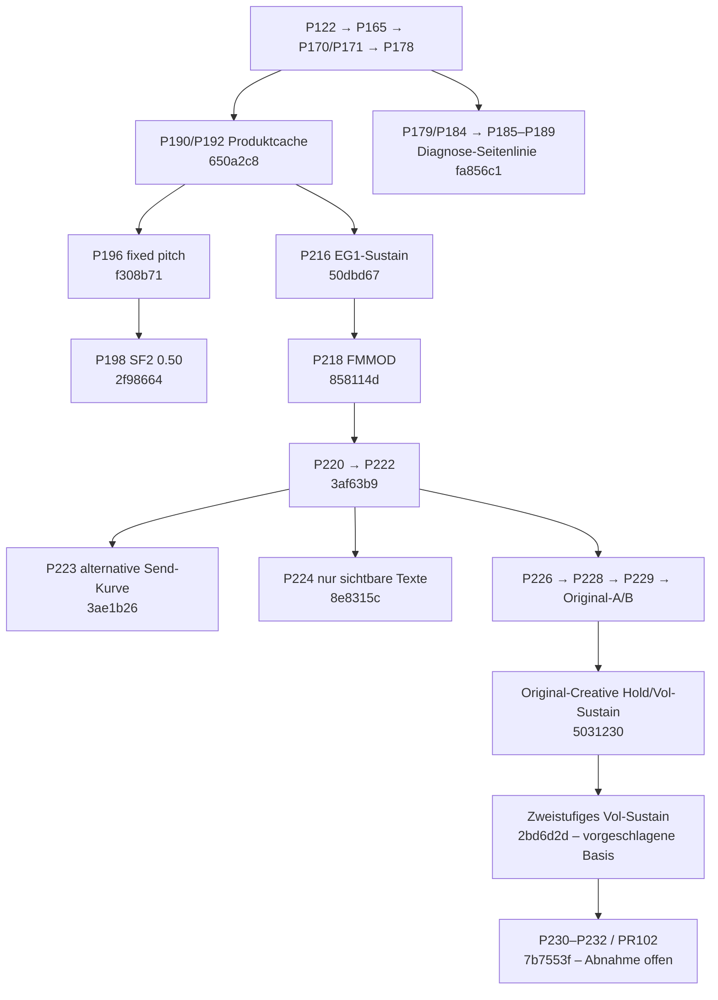

# 125A AWE – Repository- und Integrationsaudit

Stand: 11.11.2026. Auftrag: technische Bestandsaufnahme und Integrationsentscheidung, ergänzt um die vollständig gelesenen Projektleitungsanweisungen [#103](https://github.com/challanger2000/125A-AWE-Synthesizer/issues/103), einschließlich Kommentar, und [#104](https://github.com/challanger2000/125A-AWE-Synthesizer/issues/104). Keine Änderungen an Produktdateien, Test-Lab-Dateien, Remote-Refs, PRs oder Klangpfad. Keine Bereinigung, kein Merge, kein neuer Windows-Build.

## Entscheidung

**Empfohlener exakter Ausgangscommit für die spätere Konsolidierung:**

`2bd6d2d299a53f9af1e741e625d22207e08c8909`

Vorhandener Branch: `fix/creative-volume-sustain-layer-parity`.

Dies ist die geeignete reproduzierbare **Integrationsbasis**, keine vollständig abgenommene Produktversion. Sie enthält die jüngsten originaltreiberbasierten Sustain-/Hold-Korrekturen und ist unmittelbarer Elternstand der laufenden P232-Arbeit. Ihr kompletter `src`-Baum ist identisch mit dem tatsächlich erfolgreich auf Windows gebauten Commit `9f849462a3e055fab8fc919127e1897aff818520`; dazwischen änderte sich ausschließlich der native Diagnose-Exportworkflow. Root-CMake, Quellen, Tests und Abhängigkeiten wurden zusätzlich verglichen. Das belegt einen gezielt Windows-bau-/hosttestbaren Kandidaten, ersetzt keinen neuen vollständigen Integrationstest.

**Kein bestehender Commit vereinigt alle getrennt geprüften Produktkorrekturen.** Insbesondere fehlen diesem Ausgangspunkt P196 und P198 aus `fix/p190-zero-fx-dry`. Ein neuerer P-Name, ein grüner Einzelworkflow oder der größte Quellbaum liefern daher keine fertige Gesamtbasis.

**Geschützt bleibt** `qa/p230-original-rom-sbk-audio` auf `7b7553fb9562c8b65cdd1541e7066823fba10954` (PR #102). Seine 17 zusätzlichen Commits sind P230–P232-Diagnostik. Der Vergleich mit dem Basiscommit zeigt in `src/` ausschließlich die Registrierung des nativen ROM/SBK-Diagnoseprogramms in CMake, keine andere Synth-/VST3-Implementierung. P232-Abnahme steht aus; der Entwickler arbeitet dort weiter, ohne Eingriffe dieses Audits.

`main` = `2aa2d05308d25064c706d35c2e1868e9c9e8ee2d` enthält genau **README.md**. Er ist weder lauffähige Engine noch aktuelle Entwicklungsbasis. Es gibt keine veröffentlichte GitHub Release; AGENTS.md bestätigt ausdrücklich keine freigegebene Windows-FULL-Version und kein Gumroad-ZIP.

## Vollständiger Bestand und Bedeutung der Klassifizierung

| Merkmal | Ergebnis |
|---|---:|
| AWE Remote-Branches | 142 |
| Vorhandene historische Tags | 43 |
| Offene PRs / davon Draft | 54 / 53 |
| Unterschiedliche offene PR-Heads / Bases | 54 / 41 |
| Branches mit offenem Head- oder Base-Bezug | 66 |
| Weitere Branches, ohne `main` | 75 |
| Geschlossene PRs, sämtlich als gemergt ausgewiesen | 35 |
| Deren tatsächliche Merge-/Squash-Ergebnisse im Basiscommit erreichbar | 35 / 35 |
| Offene PR-Heads bereits exakt Vorfahren der Basis | 31 / 54 |
| Unterschiedliche `src`-Baumobjekte über alle Branches | 70 |

Die 142 Branches wurden nach Namen, SHA, Commit-Datum, Quellbaum, Abstammung und PR-Bezug erfasst. Alle 89 PRs wurden hinsichtlich Head, Base, Status und – bei geschlossenen PRs – tatsächlichem Merge-/Squash-SHA abgeglichen. Ein gemergter PR-Head muss bei Squash-Merges selbst kein Vorfahr sein; der separate Ergebnis-SHA ist deshalb Bestandteil des Inventars. Die abschließende erneute Remote-Abfrage ergab dieselben 142 Heads ohne SHA-Änderungen.

| Klasse | Anzahl | Bedeutung / Vorschlag |
|---|---:|---|
| A | 3 | Eine vorgeschlagene Integrationsbasis, der geschützte P232-Arbeitszweig und `main` als geschütztes zukünftiges Ziel. `main` zählt hier ausdrücklich nicht als funktionierender Arbeitsstand. |
| B | 64 | Weitere Heads/Bases offener PRs. Bis zur geprüften Disposition erhalten; bereits enthaltene Änderungen nicht erneut mergen. |
| C | 44 | Divergente Entwicklung, Forschungs-/Diagnoseevidenz oder ungeklärte Disposition. Exakten Stand erhalten und zur Archivierung vorschlagen. |
| D | 31 | Kein offener PR-Bezug, exakter Head vollständig in der Basis enthalten, null ausschließlich über diesen Branch erreichbare Commits. Bedingte Entfernungsvorschläge nach Archiv-/Evidenzprüfung und Auftraggeberfreigabe. |

**D ist keine Löschfreigabe.** Die Aussage betrifft nachgewiesene Git-Erreichbarkeit. Vor einer späteren Entfernung müssen exakter Archiv-Tag, unabhängiger erneuter Abruf, Sicherung benötigter CI-/Privatbelege und die freigegebene dauerhafte Zielreferenz geprüft sein. Auch Forschung in bereits enthaltener Historie bleibt über die vorgeschlagenen exakten Tags rekonstruierbar.

Die tabellarische Liste enthält jeden der 75 C-/D-Branches, exakten SHA, Begründung und vorgeschlagenen Archiv-Tag: [ARCHIV-LOESCHVORSCHLAEGE-75.md](ARCHIV-LOESCHVORSCHLAEGE-75.md), [CSV](ARCHIV-LOESCHVORSCHLAEGE-75.csv). Es wurden keine Tags angelegt und keine Branches entfernt.

Vollständiges maschinenlesbares Inventar: [142 Branches als CSV](BRANCH-INVENTAR-142.csv), [JSON mit Commitlisten](BRANCH-INVENTAR-142.json), [89 PRs](PR-INVENTAR-89.json), [43 vorhandene Tags](BESTEHENDE-TAGS-43.json). Jeder Branch enthält eingehende/ausgehende offene PR-Abhängigkeiten, nächste tatsächliche Vorfahren-Branchspitzen, rohe einzigartige Commits, Merge-Status und CI-/Release-Evidenzfelder. Die Definitionen stehen im [Manifest](AUDIT-MANIFEST.json). Dokumentarische CI-Links sind Such-/Prüfnachweise, kein automatisch behaupteter PASS des jeweiligen gesamten Heads.

## Produktlinie und konkurrierende Stände

Vereinfachter Graph; die Pfeile bezeichnen Abstammung bzw. funktionale Fortsetzung, keine Mergefreigabe. Der vollständige offene PR-Graph mit 66 Branchknoten und 54 Kanten liegt als [Mermaid](PR-ABHAENGIGKEITEN-54.mmd) und [JSON](PR-ABHAENGIGKEITEN-54.json) vor.

### Bereits enthaltene, geprüfte Produktkorrekturen

- P122–P128 Bank/Recall-/Intent-/ProgramChange-Korrekturen; P129/P137 CPU-Entlastung; P133 V11 und Original-FX-Modi; P134 CC120; P165-Oberfläche; P166 exakte SF2-/ROM-Isolation; P170/P171 und P175 befinden sich in der Vorfahrenkette der empfohlenen Basis. Die offenen PRs #79, #84, #86–#89 und #101 sowie #98–#100 enthalten daher keinen zusätzlich zu mergenden Head gegenüber dieser Basis. Ihr formaler PR-Status ist trotzdem offen.
- P192-Pitch-Pow-Cache wurde als `650a2c8408b7e068b84fd8a5d202e21dcaf17330` in der Produktlinie übernommen. **Nicht den gesamten separaten `perf/p192-shadow-pitch-cache` erneut übernehmen**: dort liegen zusätzlich Benchmark-/Buildarbeiten; die produktive Cacheänderung ist bereits vorhanden. Die isolierte Wiederverwendung exakt gleicher Pitch-Eingaben war PCM-/Register-identisch, keine neue Klangberechnung.
- P216 bewahrt getrennte Instrument-/Preset-Anteile für Win95-SF2-Mod-Sustain. Vollständige Windows-Regressionsbelege existieren für `50dbd6713736b9c60bb33a3a5c737e57b926fd64`, nicht pauschal für alle späteren Änderungen.
- P218 `65ffbc909867ee54e2a2819990844fa8e3bf6bc6` verhindert, dass negative SF2-Filter-LFO-Tiefe das Pitch-Byte in FMMOD überschreibt. Drei gemessene Originaltreiberfälle wurden korrigiert; die Filtermatrix blieb **21/28**, also sieben Abweichungen offen. Der herangezogene native Messworkflow läuft auf dem separaten Forschungs-SHA `273ad1d6ef9b984c749e46f45a39f4c96519aeef`; das ist keine vollständige Windows-Abnahme des späteren Produkt-Heads.
- `5d66f3c31994ba5cd5dca48eb9778cd2830e8bf3` ersetzt die zuvor widerlegte einfache Hold-ModEnv-Millisekundenrundung durch die originaltreiberbasierte VXD-Quantisierung. `de3290af18a738c54de8de2a3666d4e7ac47fd42` + `abdfcdf8372126ac7d9068dfada00d1ce140ead4` bewahren bzw. verwenden getrennt quantisierte Vol-Sustain-Anteile. Gefrorene originale Registerbeobachtungen sowie Grenzen/DOS/SF1-/Stale-Provenance-Kontrollen sind vorhanden. Das sind gezielt belegte Konverterkorrekturen, keine komplette klangliche Abnahme aller Presets.

### Fehlende Produktdeltas aus dem konkurrierenden Produktzweig

| Änderung | Exakter Commit | In `2bd6d2d`? | Beleg und Integrationsentscheidung |
|---|---|---|---|
| P196: SF2/Win95 `scaleTuning=0` tatsächlich feste Tonhöhe | `f308b71a4765e2402856e7be24105420542e37a1` | Nein | Reproduzierte Tonhöhenabweichung, gezielter Test und vollständiger Windows-Lauf vorhanden. Gezielter Übernahmekandidat nach P232-Abnahme, mit erhaltenen neuen Sustain-Pfaden und erneuter gemeinsamer Regression. |
| P198: SF2/Win95 InitialAttenuation-Faktor 0.40 → 0.50 | `2f986648d0507ba97c804b483ce00021a2f656fe` | Nein | Kontrollierte CT4390-Analogkalibrierung und vollständiger Windows-Lauf vorhanden. **Anderes Referenzziel als das primäre Win95/86Box-Orakel aus #103**; keine zurückgewonnene exakte VXD-Formel. Vor Übernahme Originaltreiber-/SF2-Kompatibilität beurteilen und Entscheidung ausdrücklich dokumentieren; kein stiller Koeffizientenwechsel. |

Die heutige Basis enthält weiterhin 0.40 und den alten `scaleTuning=0`-Pfad. Das ist ein tatsächlicher Quellunterschied, keine Folgerung aus Branch-Namen. Umgekehrt fehlen dem P198-Zweig die späteren P216/P218-/Vol-Sustain-Korrekturen. Keine der beiden Seiten darf die andere als Komplettdatei überschreiben. Der P198-Faktor ist ausschließlich die beschriebene SF2-Konvertierung; er ist **kein** Beleg für eine weitere globale ROM-Gain-Anpassung.

**Der bestehende Vollregressionsanschluss ist vorhanden:** `.github/workflows/p190-fx-zero-dry-windows.yml` baut den ausgecheckten Source-SHA, führt sämtliche CTests, den tatsächlichen Modulvalidator, drei EditorHost-Smokes, die vollständige GUI-Prüfung und das separate RT-Gate aus. Er pinnt bereits Test Lab `bf6f8fc69e88624762861dbb9a20384cfe3f09a4`. Sein automatischer Push-Trigger gilt allerdings nur für `fix/p190-zero-fx-dry`; die neueren Envelope-Workflows führen gezielte Tests aus. Für die spätere Konsolidierung diesen bestehenden Workflow gezielt an den freigegebenen Integrationsbranch anschließen und die ausgewertete SHA kontrollieren, keinen zweiten Prüfstand erstellen. Der Workflow sichert Testartefakte **vor** dem abschließenden RT-Gate: Ein vorhandenes ZIP allein beweist deshalb auch dort keinen vollständigen Lauf-PASS.

### Experimentelle Alternativen, nicht als Diagnosewerkzeuge verharmlosen

- **PR #96 / P223**, `3ae1b26322adf36e841a7e926a97352021139944`, ändert `FxSendLevel.h`: von `x*(base+(255-base)*x)` zu `round(255*x)`. Trotz „diagnostic“ im Titel ist das eine hörbare Produktänderung für Zwischenstellungen und die Beziehung zu SF2/CC-Sends. Build-/Klangabnahme fehlt laut PR. Nicht für den P232-Equal-State-Vergleich in die Shipping-Engine übernehmen; hierfür bleibt der bestehende native Referenzadapter zuständig.
- **PR #67**, `64b8f61c7a4fe5a1292867b96e5be3ef303dcbb3`, verändert die Chorus-Feedback-Quantisierung im C-Kern. Die genaue Hardwareparität ist offen. Nicht in die Konsolidierung aufnehmen; keine Chorus-Berechnung ändern.
- **PR #36** enthält eine alternative SF2-„fill-only“-Komposition mit Diagnoseumschalter statt des Produkt-Addierpfads. Forschungs-/Vergleichsevidenz erhalten, nicht als zusätzliche Produktfunktion einmischen.
- **PR #5** enthält konkurrierende selbstgeschriebene FM-Presets; die spätere Produktlinie nutzt die historischen lizenzierten IBK-Bänke. Kein AWE-Klangtreue-Fix; keinen alten Factory-/FM-Stand zurückholen.
- `research/p193-ct4390-fidelity` enthält zahlreiche Nicht-Shipping-Referenz- und widerlegte Envelope-Varianten. Nur einzelne geprüfte Produktdeltas aus ihren tatsächlichen Produktcommits betrachten, keinen Forschungsbranch insgesamt mergen.

### Diagnose, Testintegration und Dokumentation

- P179–P189: native ASIO-/ETW-Ausführung, Admin-/Schema-/Replay-Diagnostik und Pakete; kein Ersatzprodukt. AWE `qa/p189-etw-schema-observability` = `fa856c1c41ec1637b880191ea8e2bdf86f930955`, zugehöriges Test Lab `bf6f8fc69e88624762861dbb9a20384cfe3f09a4`. Die Diagnosekette zweigt bei P178 ab; alte Source-/DLL-Pins und Pakete müssen bei späterem Anschluss bewusst aktualisiert werden. **P184 nicht erneut messen.** ASIO-Grenzwerte und Release-Sperre unverändert lassen.
- P220/P222/P226/P228/P229 und P230–P232 liefern Recorder, Roh-PCM-/Preclip-/Registerauswertung und Gegenproben. 3.082 native SF2-Renders oder 397 native ROM-Renders sind keine ebenso vielen Originaltreiber-A/B-PASS. 117 Dry-Overrange-Fälle bleiben historisch ungeklärt; kein Limiter-/Headroom-/Gain-Fix auf Verdacht.
- P224 / PR #97, `8e8315c2ecab9f4a8bdbd415c1b7af5a8485a3c1`: sichtbare Status-/LCD-Texte in `Factory.cpp`, keine DSP-Korrektur. Optional separat prüfen; der PR nennt GUI-Nachweise NOT RUN. Kein Anlass, den Klangkern dafür zu ändern.
- AGENTS.md nennt noch P170/P171, README P124, START-HERE enthält mehrfach widersprüchliche aktuelle und historische Abschnitte. P230s Bericht beginnt noch mit „NOT RUN“, obwohl spätere Abschnitte reale Teilversuche beschreiben. Beim später freigegebenen Integrationsschritt genau einen aktuellen Einstieg mit Basis, Tests und offenen Gates herstellen; Chronologie getrennt erhalten.

## Konfliktprüfung ohne Ausführung eines Merges

`git merge-tree --write-tree --name-only` wurde ausschließlich in isolierten Bare-Auditkopien ausgeführt. Es erzeugte temporäre Git-Objekte; kein Branch wurde bewegt, kein Working Tree verändert, kein Mergecommit erstellt oder gepusht.

| Gegenstand relativ zu `2bd6d2d` | Textuelle Simulation | Konsequenz |
|---|---|---|
| P232 `7b7553f` | sauber; Basis ist direkter Vorfahr | Kein Nachweis der fachlichen P232-Abnahme. |
| P224 `8e8315c` | sauber | GUI-only, optional; eigener UI-Nachweis fehlt. |
| P223 `3ae1b26` | sauber | **Semantischer Klangkonflikt trotz sauberer Zusammenführung**; zurückhalten. |
| P189 `fa856c1` | Konflikt in `START-HERE.md` | Diagnosedateien/Pins gezielt anschließen, aktuelle Produktnavigation erhalten. |
| P192 `b4bf8e5` | Konflikt in `src/engine/CMakeLists.txt` | Produktcache schon enthalten; nur fehlende Bench-Evidenz/Targets bei Bedarf betrachten. |
| P190/P198-Dokumentationskopf `ce65e6b` | Konflikt in `START-HERE.md`, SoundFont textuell automatisch kombinierbar | Inhaltliche Konverter-/Referenzprüfung erforderlich; ganze Dateiübernahme würde neuere Korrekturen verlieren. |

Rohprotokolle liegen in `merge-simulation-*.txt`. Textuelle Konfliktfreiheit bestätigt weder PCM-Gleichheit noch Zustands-/MIDI-Kompatibilität.

## Konkrete Integrationsreihenfolge und Gates

1. **Jetzt keine Zusammenführung.** P232 auf dem bestehenden Arbeitszweig abschließen lassen. #103 verlangt identische ROM/SBK-/Treiber-/MIDI-/Voice-/FX-/Capture-Bedingungen, fünf gültige melodische A/Bs, Klärung der drei ungültigen Drum-Referenzen und vorab festgelegte Toleranzen. Die bisherigen fünf Pegeldifferenzen mit ungleichen Sends sind weder gültige Klangtreue-PASS noch bestätigte Klangkern-FAILs. Ergebnisse der laufenden Arbeit nicht überschreiben.
2. **Nach geprüfter P232-Abnahme und Projektleitungsentscheidung:** genau den oben genannten Commit auf dem bereits vorhandenen Branch `fix/creative-volume-sustain-layer-parity` als Integrationsausgangspunkt bestätigen. Keine weitere experimentelle Branchkette aufbauen. Das P232-Ergebnis nur im tatsächlich abgenommenen finalen SHA übernehmen; dessen späterer SHA ist heute noch nicht vorhanden und wird nicht erfunden.
3. **Fehlende geprüfte Produktdeltas einzeln abstimmen:** zuerst P196 `f308b71…` samt P90-Test. P198 `2f98664…` als gesonderte Referenz-/Verhaltensentscheidung behandeln, nicht über einen Komplettmerge unbemerkt mitnehmen. P216/P218, Hold/Vol-Sustain und deren Provenance-Fallbacks erhalten. P223, Chorus #67 und Forschungsumschalter bleiben draußen. Vorher/Nachher mit gleichem Zustand messen; beabsichtigte Änderungen auf die betroffenen Fälle begrenzen.
4. **P232-Diagnostik und aktuelle P189-Werkzeuge im vorhandenen Testpaket anschließen**, sofern für die anstehende Prüfung benötigt: exakt gepinnte Produkt-/Host-/Lab-Hashes; bestehende BAT-/PowerShell-Verfahren und Rohdatenformate wiederverwenden. Keine Wiederholung des abgeschlossenen P184-Versuchs und keine Änderung seiner Grenzen.
5. **Eine konsolidierte Windows-Regressionsrunde am endgültigen Integrations-SHA:** vollständige tatsächlich registrierte CTests, SDK-Selbsttests und vollständiger Modulvalidator getrennt ausweisen; drei EditorHost-Smokes, alle aktuellen GUI-Entscheidungen, unabhängige Test-Lab-Hosts; erster Ton, Sparse-SF2/ROM-Bänke, 16 MIDI-Kanäle, Bank/Program-Reihenfolge, laufende Automation, alte V11-Zustände, Save/Recall sowie tatsächliche PCM vor/nach Recall. FX=0 einschließlich bereits gefüllter Effektpipeline, ADSR-/Filter-/Loop-Pfade, fehlende/ungültige Medien und Wiederanlauf prüfen. RT-/Heap-Gates getrennt mit Rohwerten; keine Stimmreduktion durch Recall als Performancegewinn zählen. Tests ohne erforderliche Originalmedien ausdrücklich NOT RUN.
6. **Klang-Gates gemäß #103 erweitern:** gültige fünf GM-Fälle auf 397 ROM/SBK-Fälle, dann vier SF2-Bänke einschließlich der 117 Overrange-Fälle. Originaltreiber-/Engine-Vergleich und echter Windows-VST3-Host sind unterschiedliche Nachweisketten. Danach tatsächliche Studio-One/Fender-Studio-Pro-/ASIO-Abnahme und RT-Profil gemäß bestehendem Plan. Physische AWE64-Gold-Treue bleibt das getrennte spätere Ziel; sie wird nicht als Voraussetzung für den ersten 86Box-Orakel-Meilenstein umdefiniert.
7. **Erst nach Build-, Regression-, Klang-/DAW-Gates und Auftraggeberfreigabe** `main` als getesteten Integrationsstand übernehmen. Aktuellen Einstieg, Nachweise und Quellen-Pins gemeinsam aktualisieren. Die 31 bereits enthaltenen offenen PR-Heads dann als „bereits integriert“ zur formalen Disposition vorlegen, keine künstlichen Rückwärtsmerges in alte Bases. Archiv-/Löschvorschläge separat freigeben lassen. Keine Aktion dazu wurde in diesem Audit ausgeführt.

## Automatische Klangtreue-Fortschrittskontrolle im bestehenden Test Lab

**Es wird keine neue Testinfrastruktur benötigt.** Vorhandene Bausteine:

- Test Lab `main` `7213fe1f81f4036f74431cb5b2d7dbd09b73ee5c`: P65/P67 Produktverträge und Pflichtabdeckung; P74/P75 Ausführung; P89 zusammengeführter QA-/Lückenbericht; bestehende WAV-Referenz- und externe Capture-Prüfung. Generische technische Tests beweisen keine originale Instrumentenklangtreue.
- Vorhandener Sound-Gate-Branch `qa/p220-awe-sf2-77-sound-gate`, exakt `6cb294cdc64fa6aa30867fa3e7747105d30edb91`: `tests/p220_awe_sf2_sound_gate.py`, dessen Gegenproben und bestehende P89-Einbindung. **Diese Erweiterung ist noch nicht in aktuellem Test-Lab-main.** Ihre Integration verursacht in der isolierten Simulation einen `START-HERE.md`-Konflikt; P89-Code ist als bestehender Erweiterungspunkt vorhanden.
- AWE besitzt schon echte Windows-VST3-Recorder P171/P220, P222 Float32-Diagnostik, P226 Preclip, P230/P232 Original-Creative-/ROM/SBK-Adapter sowie P99-Fingerprints. P99s analoges CT4390-Messziel bleibt getrennt vom primären Win95/86Box-Ziel.

**Konkreter Anschluss:** In der vorhandenen AWE-Produktspezifikation/Featurematrix Test-ID und unveränderlichen Versuchsvertrag führen; Recorder und Originaltreiberadapter liefern die beiden unabhängigen Aufnahmen samt Rohbelegen. Die bestehenden Comparatoren prüfen zuerst die Vergleichsgültigkeit, danach die akustischen Grenzwerte. P89 bekommt die fallweisen Ergebnisse und den Vergleich zum freigegebenen Vorgängerbericht. Kein zweiter Runner, Emulator, Berichtsdienst oder selbstlernender Referenzgenerator.

Der P220-Vertrag ist fest auf genau eine private 77-Preset-Bank, 154 Szenarien, zwei Noten/Velocities und konstante Screening-Grenzen zugeschnitten. Er kann nicht unverändert als universelles 397-ROM-/Vier-SF2-Bank-Gate gelten. Seine bestehenden Vertrag-/Reporterfunktionen müssen bei einem später beauftragten Anschluss um die zusätzlichen vorhandenen Versuchsgruppen und Nachweise erweitert werden, ohne fehlende Fälle als bestanden zu zählen.

**Für #103 fehlende Gültigkeitsnachweise:** identische effektive Register/Sends je tatsächlicher Chip-Voice-ID und Layer, ROM/SBK-/SF2- und Originaltreiberhash, Sample-/NoteOff-/Capture-Zeitachse, genaues Produkt-Git-SHA und gebauter Modulhash, Quellenart und Toleranzversion. Gleiche CC-Werte oder gehaltene MIDI-Noten beweisen wegen mehrerer physischer SoundFont-Layer keine identischen Chipzustände. Die heutigen P220-Receipts prüfen MIDI-Werte und verschiedene Echtheitsfelder, aber noch keine vollständige Equal-State-Register-/Voice-/FX-Kette dieser Art. Detailgates mit nichtleeren Hashfeldern sind außerdem attestierte Eingaben, keine automatisch neu ausgeführten ADSR-/Filter-/Loop-Tests.

### Ausgeführte Gegenprobe zur Eignung des vorhandenen Vergleichers

Der unveränderte P220-PCM-Vergleicher aus dem obigen Lab-SHA wurde unter Linux mit selbst erzeugtem, dreisekündigem, hörbarem Stereo-PCM geprüft. Er mittelt L/R vor Pegel-, Hüllkurven- und Spektralanalyse. Ein **vollständiger Tausch der beiden unterschiedlichen Kanäle** liefert daher weiterhin **PASS**, 0.000 dB Pegeldelta, Hüllkurvenkorrelation 1.0 und 0.000 dB Spektraldelta. Die unabhängige −6.021-dB-Pegelmutation wird dagegen als FAIL erkannt. Das ist ein reproduzierter **Abdeckungsfehler für Stereoidentität**, kein nachgewiesener AWE-Produktfehler und kein Windows-/VST3-Test.

Die Komponente ist deshalb als Screening wiederverwendbar, aber nicht als alleinige automatische Klangtreuefreigabe geeignet. Beim späteren Anschluss vorhandene Stereo-/PCM-Prüfungen verwenden und Kanaltausch/Phasenumkehr als Gegenproben in den bestehenden Tests führen; keinen neuen Prüfstand bauen. Die Rohmesswerte der Gegenprobe stehen in [audio-comparator-counterexamples.json](audio-comparator-counterexamples.json). Im Bericht bedeutet das dortige Komponenten-PASS ausdrücklich **falsch-positive Erkennung des Stereo-Gegenbeispiels**, keine Freigabe.

### Verbindliche Fortschrittszahlen

Je identischem, versioniertem Versuchsvertrag ausgeben:

1. **gültig verglichen** – beide unabhängigen Aufnahmen und vollständige Equal-State-Nachweise vorhanden;
2. **Toleranz bestanden** – gültige Fälle innerhalb vorab festgelegter akustischer Grenzen;
3. **vorherige Fehler behoben** – derselbe gültige Fall war beim exakten Vorgänger-SHA rot und ist jetzt grün;
4. **Regressionen** – derselbe zuvor bestandene Fall scheitert am neuen SHA.

Zusätzlich getrennt: fehlend/NOT RUN, ungültige Referenz, ungleiche Konfiguration und nicht vergleichbare Vertrags-/Fixture-/Toleranzänderung. Keine Verbesserung durch Nennerverkleinerung, geänderte Aufnahmebedingungen, Referenzneuerzeugung oder pro Note normalisierte Lautstärke. RMS/Peak, Envelope, Stereo, Spektrum und gegebenenfalls Samplegleichheit einzeln erhalten. Grenzwertänderungen sind Vertragsversionen, keine rückwirkend behobenen Klangfehler.

Der heute nachgewiesene Startstatus des neuen Equal-State-Meilensteins ist **kein Klang-PASS**: 397 native Aufnahmen vorhanden; fünf originale melodische Aufnahmen mit ungleichen Effektbedingungen; drei ungültige Drum-Referenzen. Gültige P232-Equal-State-Abnahme und deren Vorher-/Nachher-Regressionszahlen **NOT RUN / noch nicht belegt**. Die 77-Preset-Abnahme ist ein eigenes Gate und darf weder aus 397 nativen Renders noch aus den 28 Registervektoren abgeleitet werden.

## Nachweismatrix und Grenzen

Die direkt abgeglichenen Run-SHAs und Statusangaben sind zusätzlich in [CI-NACHWEISE.json](CI-NACHWEISE.json) festgehalten. Die [54 offenen PRs mit vorgeschlagener Disposition](OFFENE-PRS-54.md) sind separat tabellarisch aufbereitet.

GitHub-Runstatus und zugehöriger Source-/Branch-Bezug wurden auf den folgenden Runseiten direkt nachgesehen. Umfang/Einzelzahlen stammen zusätzlich aus den zugehörigen gelesenen Workflows und Produktberichten. Nicht sämtliche historischen Rohlogs oder privaten Originalartefakte wurden in diesem Audit erneut geprüft; das Inventar kennzeichnet andere CI-Links ausdrücklich nur als dokumentarische Fundstellen.

| Gegenstand | Exakter Bezug / Nachweis | Urteil im Audit |
|---|---|---|
| Aktueller Ausgangspunkt Windows-bau-/hosttestbar | `9f849462a3e055fab8fc919127e1897aff818520`, [#42914748145](https://github.com/challanger2000/125A-AWE-Synthesizer/actions/runs/42914748145), SUCCESS. Drei gezielte CTest-Namen im Workflow, SDK-Buildvalidierung, zwei synthetische WAVs aus echtem exportierten VST3; Root-/src-/Tests-Baum äquivalent zu `2bd6d2d`. | Gezielt belegte Windows-Ausführbarkeit; **keine** vollständigen 537 Modul-/99 GUI-/RT-Gates dieses Gesamtstands. |
| Exakter aktueller Head nativer Build | `2bd6d2d…`, [#42914819015](https://github.com/challanger2000/125A-AWE-Synthesizer/actions/runs/42914819015), SUCCESS; native Diagnoseexport-Archivdigest `ec398e112a1da7990209c8f8e001929d97a7d39b0bebd7602a4ec90fb37acb34`. | Native Linux-/Konverterevidenz, kein Windows-Gesamttest. |
| Vorangehender nativer Sustain-Test | `e3a90d6…`, [#42914457295](https://github.com/challanger2000/125A-AWE-Synthesizer/actions/runs/42914457295), SUCCESS. | Gezielte Originalregister-/Fallbackkontrollen; keine akustische Gesamtabnahme. |
| P196 | `f308b71…`, [#42588685864](https://github.com/challanger2000/125A-AWE-Synthesizer/actions/runs/42588685864), SUCCESS. | Dokumentiert: 67 CTests, 537 Modulvalidator, 99 GUI, 3 Smokes, Test Lab, 0/14.400 LAB_ONLY. In ausgewählter Basis fehlt diese Korrektur. |
| P198 | `2f986648…`, [#42593301776](https://github.com/challanger2000/125A-AWE-Synthesizer/actions/runs/42593301776), SUCCESS. | Gleiche dokumentierte Vollregressionsgrößen; andere Konverter-/Referenzvariante, kein Beleg für die Kombination mit neuem Sustain. |
| P216 | `50dbd671…`, [#42742531063](https://github.com/challanger2000/125A-AWE-Synthesizer/actions/runs/42742531063), SUCCESS. | Dokumentiert: Original-EG1 28/28 plus vollständige Windows-Suite. Spätere FMMOD/Hold/Vol-Sustain-Änderungen nicht rückwirkend abgenommen. |
| P218 native Registermessung | Forschungs-SHA `273ad1d…`, [#42750226234](https://github.com/challanger2000/125A-AWE-Synthesizer/actions/runs/42750226234), SUCCESS. | Originalregistermatrix 21/28, sieben FAIL bleiben; keine vollständige Produktabnahme. |
| 142 Branches / 89 PRs | Remote-SHAs, Git-DAG, alle PR-Metadaten, 35 tatsächliche Merge-/Squash-SHAs, abschließende Remote-Gegenabfrage. | Bestands-/Abhängigkeitsinventar geprüft; keine Aussage „alle Produktfunktionen geprüft“. |
| P232, 397 Equal-State-A/B, Vier-Bank-Originalvergleich | Originalteilbelege und neue Anforderungen #103. | Abnahme **NOT RUN / nicht belegt**, ungültige oder ungleiche Fälle separat. |
| Neue Windows-Integration, vollständiger Funktionsaudit, reale DAW/ASIO | Kein neuer solcher Lauf in diesem Audit. | **NOT RUN**. Bestehende P184-Evidenz bleibt erhalten, wurde nicht wiederholt oder uminterpretiert. |

**Ergebnis:** Eine exakt bestimmte Integrationsbasis und ein überprüfbarer, bedingter Konsolidierungsplan liegen vor. Ein alle Produktdeltas vereinigender und vollständig geprüfter Integrationscommit existiert noch nicht. **Klang-/DAW-/Release-NO-GO bleibt bestehen.** Kein FULL-AUDIT-, Echtzeit- oder Produkt-PASS wird aus diesem Repositoryaudit abgeleitet. Die einzige unmittelbar anstehende fachliche Entscheidung ist weiterhin P232 gemäß #103; anschließend die Abnahme dieses Integrationsplans gemäß #104.
